# Project A: CNN from Scratch — CIFAR-10 Image Classifier

<p align="center">
  <strong>Deep Learning Practical Project</strong><br>
  Image Classification with Convolutional Neural Networks
</p>

<p align="center">
  
  
  
  
  
</p>

---

## Table of Contents

- [1. Project Overview](#1-project-overview)
- [2. Project Objectives](#2-project-objectives)
- [3. Problem Statement](#3-problem-statement)
- [4. Dataset Description](#4-dataset-description)
- [5. CIFAR-10 Classes](#5-cifar-10-classes)
- [6. Project Structure](#6-project-structure)
- [7. Technology Stack](#7-technology-stack)
- [8. Environment Setup](#8-environment-setup)
- [9. Installation](#9-installation)
- [10. How to Run the Notebook](#10-how-to-run-the-notebook)
- [11. Workflow](#11-workflow)
- [12. Task A1 — Data Loading and Exploration](#12-task-a1--data-loading-and-exploration)
- [13. Task A2 — Convolution Demonstration](#13-task-a2--convolution-demonstration)
- [14. Task A3 — Pooling and CNN Architectures](#14-task-a3--pooling-and-cnn-architectures)
- [15. Task A4 — CNN Training and Evaluation](#15-task-a4--cnn-training-and-evaluation)
- [16. Task A5 — Data Augmentation](#16-task-a5--data-augmentation)
- [17. Task A6 — Transfer Learning](#17-task-a6--transfer-learning)
- [18. Task A6.5 — Model Comparison](#18-task-a65--model-comparison)
- [19. Task A6.6 — Residual Connection](#19-task-a66--residual-connection)
- [21. Evaluation Metrics](#21-evaluation-metrics)
- [22. Results Table](#22-results-table)
- [23. Expected Observations](#23-expected-observations)
- [24. Reproducibility](#24-reproducibility)
- [25. Troubleshooting](#25-troubleshooting)
- [26. Performance and Runtime Notes](#26-performance-and-runtime-notes)
- [27. Limitations](#27-limitations)
- [28. Future Improvements](#28-future-improvements)
- [29. Learning Outcomes](#29-learning-outcomes)
- [30. References](#30-references)
- [31. Final Submission Checklist](#31-final-submission-checklist)

---

## 1. Project Overview

This project builds and evaluates image-classification models using the CIFAR-10 dataset.

The work starts with data exploration and image preprocessing.
It then introduces convolution, padding, strides, feature maps, and pooling.
Several CNN architectures are trained and compared.
Data augmentation is used to improve the diversity of training examples.
Transfer learning is explored using a pretrained MobileNetV2 network.
Finally, a residual connection is built with the Keras Functional API.

The project is implemented in Python using TensorFlow and Keras.
The main deliverable is a Jupyter Notebook named `DL_PR4A.ipynb`.

The notebook is designed for educational use.
It demonstrates how different model designs and training strategies affect image classification.
Actual accuracy values are generated when the notebook is executed.
No test accuracy is assumed or hard-coded in this README.

### Main deliverables

- `DL_PR4A.ipynb` — complete implementation and experiments.
- `README.md` — project documentation.
- `requirements.txt` — Python package requirements.
- Notebook outputs — charts, model summaries, and evaluation results after execution.

---

## 2. Project Objectives

The main objectives are:

1. Load the CIFAR-10 dataset through Keras.
2. Inspect the shape and distribution of the data.
3. Display examples from all ten image classes.
4. Normalize pixel values to a consistent numerical range.
5. Convert class labels to one-hot encoded vectors.
6. Demonstrate a convolution operation with a simple filter.
7. Compare `VALID` and `SAME` padding.
8. Explain how stride changes the output dimensions.
9. Visualize feature maps produced by a convolution layer.
10. Compare max pooling and average pooling.
11. Build a LeNet-5-style CNN.
12. Build a custom CNN with fewer than two million parameters.
13. Train a CNN with validation monitoring.
14. Apply early stopping and learning-rate reduction.
15. Evaluate models using a held-out test set.
16. Inspect class-level predictions and misclassified images.
17. Apply image augmentation with `ImageDataGenerator`.
18. Apply augmentation through Keras preprocessing layers.
19. Use MobileNetV2 as a pretrained feature extractor.
20. Fine-tune selected MobileNetV2 layers.
21. Compare all required models in a pandas DataFrame.
22. Highlight the highest measured test accuracy.
23. Build a residual block with a shortcut connection.
24. Document observations, limitations, and possible improvements.

---

## 3. Problem Statement

Image classification assigns an image to one of a predefined set of categories.
A model learns patterns from labeled training images and uses those patterns to predict the category of an unseen image.

The task in this project is to classify small RGB images into ten CIFAR-10 categories.
Each image has a resolution of 32 by 32 pixels.
At this low resolution, some categories have similar visual patterns.
For example, cats and dogs can be difficult to distinguish.
Automobiles and trucks may also share visual features.

The project compares multiple approaches to understand the trade-offs among:
- model complexity;
- training time;
- number of trainable parameters;
- augmentation strategy;
- use of pretrained features;
- final test accuracy.

The goal is not to claim that one model always wins.
The goal is to run the experiments, record the measured results, and explain those results accurately.

---

## 4. Dataset Description

The project uses the CIFAR-10 dataset provided by Keras.

CIFAR-10 contains 60,000 color images divided into ten classes.
The images are small, making the dataset suitable for introductory computer-vision experiments.

| Property | Description |
|---|---|
| Dataset name | CIFAR-10 |
| Total images | 60,000 |
| Training images | 50,000 |
| Test images | 10,000 |
| Image dimensions | 32 × 32 pixels |
| Image channels | 3 RGB channels |
| Number of classes | 10 |
| Label type | Integer class IDs |
| Training label shape | `(50000, 1)` |
| Test label shape | `(10000, 1)` |
| Training image shape | `(50000, 32, 32, 3)` |
| Test image shape | `(10000, 32, 32, 3)` |

### Loading the dataset

The notebook loads the dataset with:

```python
from tensorflow import keras

(X_train_raw, y_train_raw), (X_test_raw, y_test_raw) = (
    keras.datasets.cifar10.load_data()
)
```

The first run may download the dataset automatically.
An internet connection may be required for the initial download.

### Training, validation, and test data

- **Training data** is used to update model weights.
- **Validation data** is used to monitor training and select model settings.
- **Test data** is used for final evaluation.

The test set should not be used to tune model parameters.
In this project, validation samples are taken from the training data.
The separate CIFAR-10 test set is kept for final evaluation.

---

## 5. CIFAR-10 Classes

CIFAR-10 has the following ten classes:

| Class ID | Class name |
|---:|---|
| 0 | Airplane |
| 1 | Automobile |
| 2 | Bird |
| 3 | Cat |
| 4 | Deer |
| 5 | Dog |
| 6 | Frog |
| 7 | Horse |
| 8 | Ship |
| 9 | Truck |

The notebook defines these names in a list so that numeric predictions can be displayed as readable class labels.

```python
class_names = [
    "Airplane", "Automobile", "Bird", "Cat", "Deer",
    "Dog", "Frog", "Horse", "Ship", "Truck"
]
```

Class names are used in plots, reports, and the confusion matrix.

---

## 6. Project Structure

Keep the main files together in one project folder.

```text
CIFAR10-CNN-Project/
├── DL_PR4A.ipynb
├── README.md
├── requirements.txt
└── output/
    ├── CIFAR-10_5_Samples.png
    ├── Histogram_Befor_Normalisation.png
    ├── Histogram_After_Normalisation.png
    ├── Original_image_vs_convolved_image.png
    ├── 16_Feature_map_image.png
    ├── Feature_map_Aftermaxpooling.png
    ├── Feture_map_after_averagepooling.png
    ├── CNN_Traning_Curves.png
    ├── CIFAR-10_Confusion_matrix.png
    ├── Misclassified_images.png
    ├── Augmentation_image.png
    ├── Augmentation_Traning_Curves.png
    └── Feature_Extraction_vs_Fine_tuning.png
```

The `output/` folder contains the screenshots embedded individually in the matching task sections below. Save each screenshot using the exact filename and `.png` extension shown here. If your files use another extension, update that image path in the relevant section.

---

## 7. Technology Stack

### Python

Python is the programming language used for data preparation, modeling, evaluation, and visualization.

### TensorFlow and Keras

TensorFlow provides the deep-learning runtime.
Keras provides APIs for defining, training, and evaluating neural networks.

### NumPy

NumPy handles arrays, numeric transformations, and index selection.

### pandas

pandas is used to create the final model-comparison DataFrame.

### Matplotlib

Matplotlib creates image grids, histograms, learning curves, and comparison plots.

### scikit-learn

scikit-learn provides classification metrics and confusion-matrix utilities.

### Jupyter Notebook

Jupyter allows code, charts, model summaries, and Markdown explanations to be kept in one document.

---

## 8. Environment Setup

Use a Python environment supported by the TensorFlow version installed on your computer.

Before installing packages, check the Python version:

```bash
python --version
```

Check pip:

```bash
python -m pip --version
```

If you have several Python installations, ensure that VS Code or Jupyter uses the same environment where the required packages are installed.

### Recommended approach

Create a virtual environment inside the project folder.

On Windows:

```bash
py -3.12 -m venv .venv
```

Activate it in Command Prompt:

```bat
.venv\Scripts\activate
```

Activate it in PowerShell:

```powershell
.\.venv\Scripts\Activate.ps1
```

If activation is blocked by a computer policy, use the environment's Python executable directly or follow the policy set by your device administrator.
Do not disable Windows security controls to install a package.

---

## 9. Installation

### Step 1 — Open the project folder

Open the folder containing `DL_PR4A.ipynb` in VS Code or navigate to it in a terminal.

### Step 2 — Activate the virtual environment

Use the activation command for your terminal, as shown above.

### Step 3 — Install requirements

Run:

```bash
python -m pip install -r requirements.txt
```

### Step 4 — Check imports

Run this in a notebook cell:

```python
import numpy as np
import pandas as pd
import matplotlib.pyplot as plt
import tensorflow as tf
from tensorflow import keras
import sklearn

print("NumPy:", np.__version__)
print("pandas:", pd.__version__)
print("TensorFlow:", tf.__version__)
print("scikit-learn:", sklearn.__version__)
```

If the imports work, the basic environment is ready.

### Step 5 — Select the notebook kernel

In VS Code, open the notebook and select the Python kernel that corresponds to your project environment.
A notebook can fail to import a package if its kernel uses a different environment from the terminal.

---

## 10. How to Run the Notebook

1. Open `DL_PR4A.ipynb`.
2. Select the correct Python kernel.
3. Run the cells from the top to the bottom.
4. Allow CIFAR-10 to download if it is not already cached.
5. Inspect the plots and model summaries.
6. Wait for each training cell to finish.
7. Check that all model evaluation variables are defined.
8. Review the A6.5 results table.
9. Read the final observations and write conclusions based on actual results.
10. Save the notebook after execution.

### Important execution note

The notebook trains multiple models.
Training every model can take a long time, particularly on a CPU.
For a quick code test, temporarily reduce the epoch limits.
For the final submission, use the training settings required by your assignment and clearly document any changes.

Run cells in order.
Skipping a training cell can leave variables such as `test_accuracy_lenet` or `test_accuracy_ft` undefined.

---

## 11. Workflow

The high-level workflow is:

1. Load CIFAR-10.
2. Inspect the images and labels.
3. Visualize the class distribution.
4. Normalize the image data.
5. One-hot encode the labels.
6. Demonstrate convolution and feature maps.
7. Compare pooling operations.
8. Build and train LeNet-5.
9. Build and train a custom CNN.
10. Evaluate the scratch CNN.
11. Train an augmented CNN using `ImageDataGenerator`.
12. Train a CNN with Keras augmentation layers.
13. Resize images for MobileNetV2.
14. Train a frozen-feature-extractor model.
15. Fine-tune selected pretrained layers.
16. Compare model accuracy and parameter counts.
17. Build a residual connection.
18. Document conclusions and limitations.

---

## 12. Task A1 — Data Loading and Exploration

### Purpose

Understand the dataset before training a model.

### Work completed

- Load the training and test sets.
- Print the shapes of images and labels.
- Display the number of examples per class.
- Plot a bar chart of the training class distribution.
- Show five sample images for each class.
- Normalize pixel values.
- Convert labels to one-hot encoded vectors.
- Plot a comparison of original and normalized pixel values.

**Screenshot — five samples from each CIFAR-10 class**

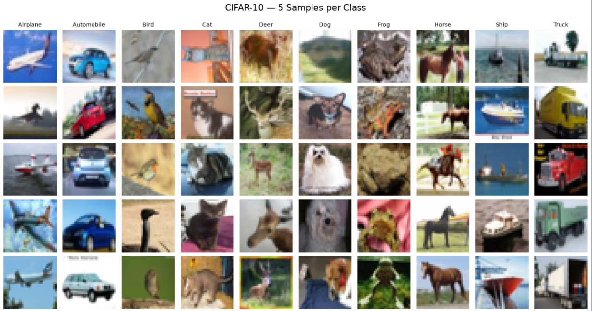

### Normalization

Raw pixel values usually range from 0 to 255.
Dividing by 255 converts them to the range 0 to 1.

```python
X_train = X_train_raw.astype("float32") / 255.0
X_test = X_test_raw.astype("float32") / 255.0
```

Normalization helps keep input magnitudes consistent during training.

**Screenshot — pixel distribution before normalization**

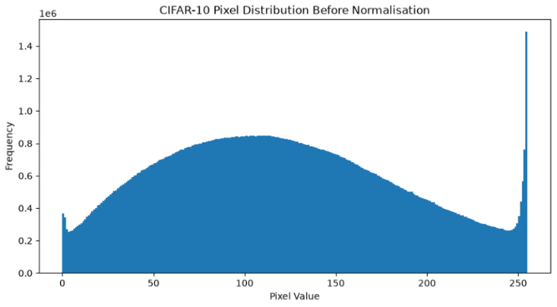

**Screenshot — pixel distribution after normalization**

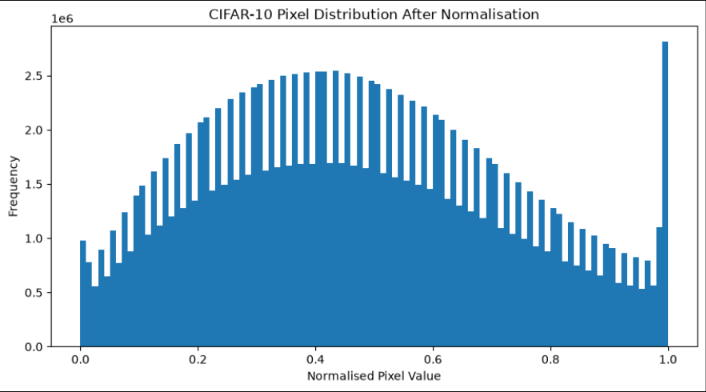

### One-hot encoding

A class ID such as `3` becomes a vector with ten positions.
The position for class 3 is 1, and the other positions are 0.

```python
y_train_ohe = keras.utils.to_categorical(y_train_raw, 10)
y_test_ohe = keras.utils.to_categorical(y_test_raw, 10)
```

### CNN versus ANN

A conventional fully connected neural network often flattens an image into a long vector.
A CNN applies filters to local image regions and shares the same filter weights across positions.
This allows CNNs to learn local patterns such as edges, textures, and shapes.

### Expected observation

Images from the same class share broad patterns, but individual images can differ in background, scale, color, and orientation.
Some categories are visually similar at low resolution.
These factors make CIFAR-10 a useful classification benchmark.

---

## 13. Task A2 — Convolution Demonstration

### Purpose

Understand how convolution filters extract local patterns.

### Work completed

- Define a small numerical image.
- Define a simple edge-detection filter.
- Apply a convolution operation.
- Compare padding modes.
- Compare stride settings.
- Visualize 16 convolution feature maps.

### Convolution

A convolution filter moves across an input image.
At each location, it combines the filter values with the corresponding input values.
The resulting number contributes to an output feature map.

**Screenshot — original image compared with its convolved result**

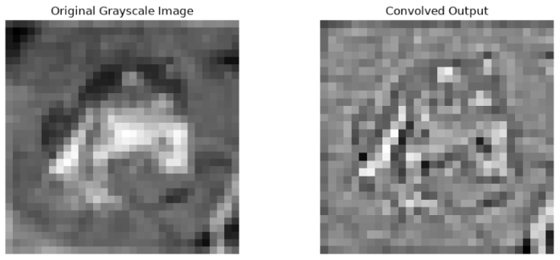

Filters can learn to respond to patterns such as edges, textures, or more complex features.

### Padding

- `VALID` does not add padding around the image.
- `SAME` pads the input so that the output dimensions are approximately preserved when stride is 1.

The precise output shape depends on the input size, kernel size, padding, and stride.

### Stride

Stride is the number of pixels by which the filter moves each step.
A larger stride typically reduces the spatial dimensions of the output.

### Feature maps

A convolution layer can contain multiple filters.
Each filter produces its own feature map.
The notebook displays 16 feature maps from a convolution layer to demonstrate this concept.

**Screenshot — 16 convolution feature maps**

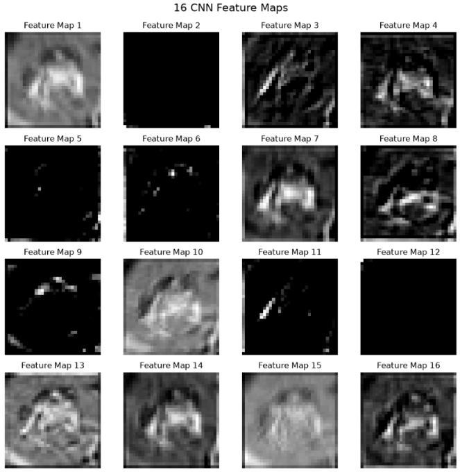

### Expected observation

Different filters produce different activations.
Randomly initialized filters may not yet represent meaningful learned patterns.
Feature maps from a trained model are generally more informative than maps from an untrained demonstration layer.

---

## 14. Task A3 — Pooling and CNN Architectures

### Purpose

Study downsampling and compare CNN designs.

### Max pooling

Max pooling selects the largest value within each local window.
It can preserve strong activations while reducing spatial resolution.

**Screenshot — feature maps after max pooling**

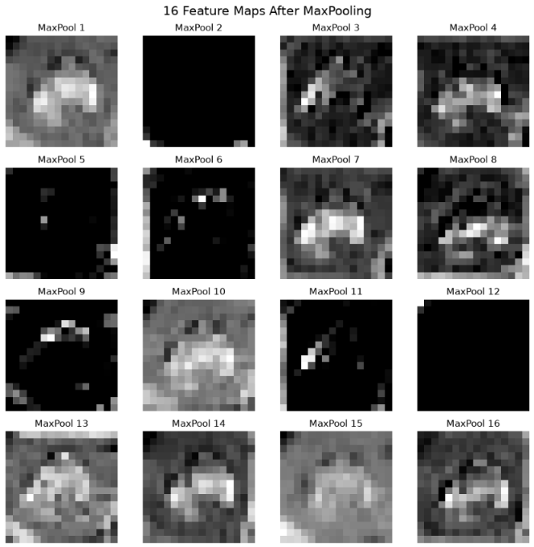

### Average pooling

Average pooling calculates the mean of each local window.
It produces a smoother summary of the values in that window.

**Screenshot — feature maps after average pooling**

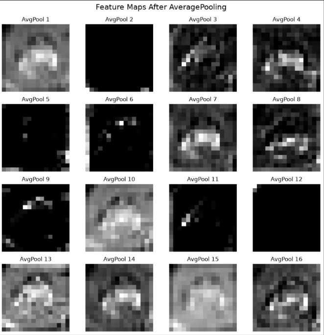

### Flatten

Flatten converts a multi-dimensional feature tensor into a one-dimensional vector.
It is commonly used before fully connected layers.
Global average pooling is another option that averages each feature channel over its spatial dimensions.

### LeNet-5-style model

The notebook implements a LeNet-5-style architecture adapted to RGB images and ten output classes.

The model includes:
- convolution layers;
- average pooling;
- a flattening layer;
- fully connected layers;
- a softmax output layer.

This is an educational adaptation rather than an exact reproduction of every detail of the original LeNet-5.

### Custom CNN

The custom CNN includes multiple convolution blocks and a global average pooling layer.
It ends with a dense classification head and a ten-class softmax output.

The notebook prints the total parameter count.
It also checks that the model has fewer than two million parameters.

### Why use global average pooling?

Global average pooling reduces each feature channel to one value.
It can reduce the number of parameters compared with flattening a large feature tensor before a dense layer.

### Expected observation

A deeper model can learn more complex patterns, but architecture alone does not guarantee better accuracy.
The result also depends on training duration, optimization, regularization, and data handling.

---

## 15. Task A4 — CNN Training and Evaluation

### Purpose

Train a custom CNN from scratch and inspect its generalization performance.

### Training configuration

The notebook uses:
- Adam optimizer;
- categorical cross-entropy loss;
- accuracy as a training metric;
- up to 100 epochs;
- batch size of 64;
- a validation split of 10%;
- early stopping;
- learning-rate reduction when validation loss stops improving.

Use the exact settings required by the assignment if they differ from these defaults.

### Early stopping

Early stopping monitors a selected metric, such as validation loss.
If the metric does not improve for the configured patience period, training stops.
With `restore_best_weights=True`, the best monitored weights are restored.

### ReduceLROnPlateau

`ReduceLROnPlateau` reduces the learning rate when the monitored validation metric stops improving.
This can help the optimizer make smaller updates during later training.

### Evaluation outputs

The notebook generates:
- test loss;
- test accuracy;
- training and validation accuracy curves;
- training and validation loss curves;
- a classification report;
- a confusion matrix;
- examples of misclassified images.

**Screenshot — CNN training and validation curves**

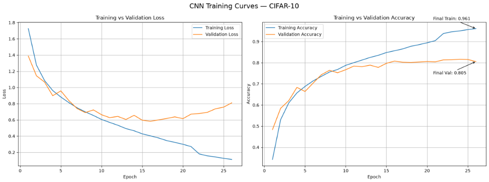

### Confusion matrix

A confusion matrix compares true class labels with predicted class labels.
Diagonal entries represent correct predictions.
Off-diagonal entries show which classes are being confused.

**Screenshot — CIFAR-10 confusion matrix**

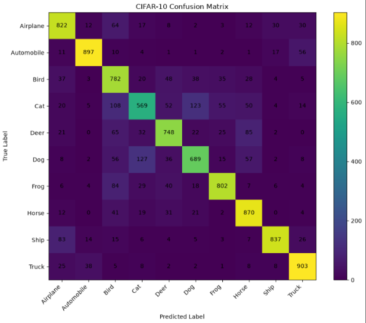

### Misclassified images

The notebook displays a selection of test images where the predicted class differs from the true class.
Reviewing these examples can reveal confusing class pairs and difficult image conditions.

**Screenshot — examples of misclassified images**

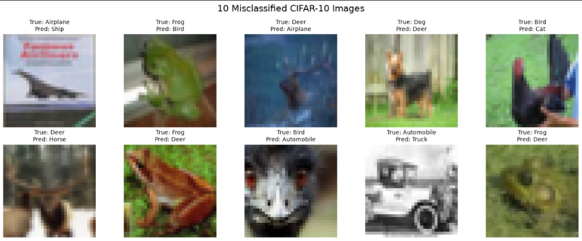

### Important note

A high training accuracy does not necessarily imply high test accuracy.
Compare training and validation curves to look for possible overfitting.
Use the held-out test set for final reporting, not repeated tuning.

---

## 16. Task A5 — Data Augmentation

### Purpose

Increase the variety of training inputs through label-preserving transformations.

Data augmentation creates altered versions of training images.
Common transformations include small rotations, translations, horizontal flips, and zoom operations.

Augmentation does not create new manually labeled images.
It transforms existing training examples while retaining their class labels.

### A5.3 — ImageDataGenerator

The notebook uses `ImageDataGenerator` with transformations such as:
- rotation;
- horizontal and vertical shifts;
- horizontal flips;
- zoom;
- nearest-neighbor fill for newly exposed regions.

The generator creates augmented batches during training.
A custom CNN is trained on these batches and evaluated on the original held-out test images.

**Screenshot — image augmentation examples**

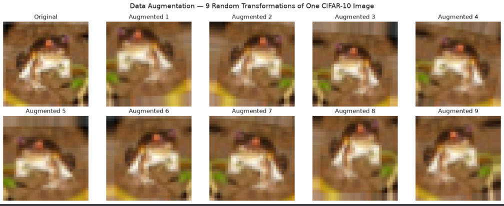

**Screenshot — augmentation model training curves**

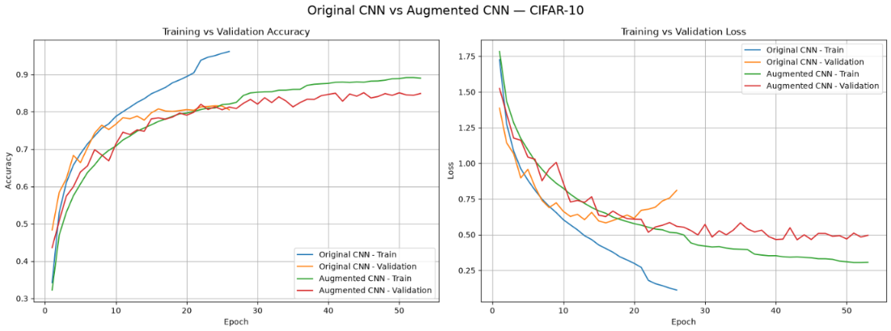

### A5.4 — Keras augmentation layers

The notebook also uses Keras preprocessing layers:
- `RandomFlip`;
- `RandomRotation`;
- `RandomZoom`;
- `RandomTranslation`.

These layers are included in a Functional API model.
This approach keeps augmentation within the model pipeline.

### Why compare both methods?

Both methods can generate varied training examples, but their interfaces and execution behavior differ.
The results may also differ because of random transformations, optimization, and training duration.

### Validation strategy

A validation subset is taken from the original training data.
The test set is not used as the augmentation validation set.

### Expected observation

Augmentation may improve generalization by making the model less sensitive to small image transformations.
It may also make training take longer.
Improvement is not guaranteed for every run, so use the measured results.

---

## 17. Task A6 — Transfer Learning

### Purpose

Use features learned by a model pretrained on a larger image dataset.

Transfer learning can reduce the need to learn every visual feature from scratch.
This project uses MobileNetV2 with ImageNet pretrained weights.

### Image resizing

MobileNetV2 is configured to accept 96 × 96 RGB images.
CIFAR-10 images are resized from 32 × 32 to 96 × 96 for this experiment.

Resizing changes the spatial resolution, but it does not add new image detail.
The resized images still originate from the original CIFAR-10 images.

### Input scaling

The CIFAR-10 images are initially normalized to the range 0 to 1.
The model uses a rescaling layer to map this range to -1 to 1 before the MobileNetV2 base.

### A6.3 — Feature extraction

In the feature-extraction stage:
- load MobileNetV2 without its original classifier;
- freeze the pretrained base model;
- add a global average pooling layer;
- add a dense classification layer;
- add a ten-class softmax output;
- train the new classification head.

Freezing the base prevents its weights from changing during this stage.

### A6.4 — Fine-tuning

In the fine-tuning stage:
- unfreeze the base model;
- keep earlier layers frozen;
- allow selected later layers to train;
- keep batch-normalization layers frozen for stability;
- use a small learning rate;
- monitor validation performance.

Fine-tuning can adapt pretrained features to the target dataset.
It also increases computational cost and can overfit if not controlled.

### Feature extraction versus fine-tuning

| Feature extraction | Fine-tuning |
|---|---|
| Pretrained base is frozen | Selected base layers are trainable |
| Usually fewer trainable parameters | More trainable parameters |
| Often faster to train | Usually more computationally expensive |
| Learns a new classifier head | Adapts some pretrained features |
| Useful as a transfer-learning baseline | Useful when adaptation improves results |

### Expected observation

Transfer learning can be helpful when pretrained features are useful for the target task.
However, resizing small images and using a pretrained model do not guarantee a higher score than a well-trained custom CNN.
Use the final measured test accuracies to compare the approaches.

**Screenshot — MobileNetV2 feature extraction versus fine-tuning**


---

## 18. Task A6.5 — Model Comparison

### Purpose

Create a complete pandas DataFrame comparing the six required models.

The table includes:
- model name;
- architecture;
- augmentation approach;
- transfer-learning setting;
- measured test accuracy;
- total parameter count.

### Required rows

1. LeNet-5 (Task A3.3).
2. CNN Scratch No Aug (Task A4).
3. CNN Scratch + Aug (Task A5.3).
4. CNN + Keras Aug Layers (Task A5.4).
5. MobileNetV2 Feature Extraction (Task A6.3).
6. MobileNetV2 Fine-Tuned (Task A6.4).

### Highlighting

The notebook uses pandas Styler `highlight_max` to highlight the maximum value in the Test Accuracy column.
The table is sorted by measured test accuracy for convenient review.

### Interpreting the table

Do not assume that accuracy must increase at every step.
Compare the actual numbers produced by your run.

A useful discussion should mention:
- which model achieved the highest test accuracy;
- how the scratch CNN compares with LeNet-5;
- whether augmentation improved the result;
- whether Keras augmentation and `ImageDataGenerator` differ;
- whether MobileNetV2 feature extraction was effective;
- whether fine-tuning improved the feature-extraction result;
- the parameter-count and training-time trade-offs.

The final written summary should match the notebook outputs.
Do not replace measured results with sample or guessed values.

---

## 19. Task A6.6 — Residual Connection

### Purpose

Build a minimal residual block using the Keras Functional API.

The block has two paths:
- a shortcut path with a 1 × 1 convolution;
- a main path with two 3 × 3 convolution layers.

The two outputs are added and passed through a final ReLU activation.

### Architecture

```text
Input image
    |
    +---------------- Shortcut: Conv2D(64, 1×1, SAME) --------+
    |                                                          |
    +-- Conv2D(64, 3×3, ReLU, SAME)                            |
          |                                                    |
        Conv2D(64, 3×3, ReLU, SAME)                             |
          |                                                    |
          +---------------------- Add <-------------------------+
                                  |
                            ReLU activation
                                  |
                               Output
```

### Why use a shortcut?

A shortcut provides a direct path through which information and gradients can travel.
This can help mitigate optimization difficulties and vanishing gradients in deep networks.

Residual connections do not guarantee that vanishing gradients are completely eliminated.
They are a key design idea behind ResNet.

### Functional API

The Keras Functional API is suitable for models with multiple branches.
Unlike a strictly linear stack of layers, it allows separate paths to be combined.

The notebook prints the model summary and checks the output shape using a sample input.

### Reference

He, K., Zhang, X., Ren, S., and Sun, J.
“Deep Residual Learning for Image Recognition.”
Proceedings of the IEEE Conference on Computer Vision and Pattern Recognition (CVPR), 2016.

---

## 21. Evaluation Metrics

### Accuracy

Accuracy is the proportion of all predictions that are correct.

\[
\text{Accuracy} =
\frac{\text{Correct Predictions}}{\text{Total Predictions}}
\]

Accuracy provides a simple overall measure, but it does not show which classes are most frequently confused.

### Precision

Precision measures how many predictions for a class were correct.

\[
\text{Precision} =
\frac{TP}{TP + FP}
\]

Here, `TP` means true positives and `FP` means false positives for the class being considered.

### Recall

Recall measures how many actual examples of a class were identified correctly.

\[
\text{Recall} =
\frac{TP}{TP + FN}
\]

Here, `FN` means false negatives.

### F1-score

The F1-score combines precision and recall using their harmonic mean.

\[
F1 = 2 \times
\frac{\text{Precision} \times \text{Recall}}
{\text{Precision} + \text{Recall}}
\]

The classification report provides precision, recall, F1-score, and support for each class.

### Loss

Categorical cross-entropy measures the difference between the true one-hot labels and predicted class probabilities.
Lower loss is generally better when comparing the same task and loss definition.

### Parameter count

Parameter count reports the number of model weights and biases.
A higher parameter count does not automatically imply better accuracy.
Training time and memory usage also depend on layer operations, input resolution, batch size, and hardware.

---

## 22. Results Table

After all model training and evaluation cells have completed, use the table generated by Task A6.5.

Record the results here if your submission requires a written summary.

| Model | Test accuracy | Parameters |
|---|---:|---:|
| LeNet-5 | Fill from notebook | Fill from notebook |
| CNN Scratch No Aug | Fill from notebook | Fill from notebook |
| CNN Scratch + Aug | Fill from notebook | Fill from notebook |
| CNN + Keras Aug Layers | Fill from notebook | Fill from notebook |
| MobileNetV2 Feature Extraction | Fill from notebook | Fill from notebook |
| MobileNetV2 Fine-Tuned | Fill from notebook | Fill from notebook |

These cells are intentionally not populated with invented values.
Copy the actual output values from your run.

### Suggested results discussion

Use this template after evaluating the models:

- The highest measured test accuracy was achieved by **[model name]**.
- Its test accuracy was **[measured percentage]**.
- Compared with the scratch CNN, **[model name]** performed **[better / similarly / worse]**.
- The augmentation experiment **[improved / did not improve]** test accuracy in this run.
- MobileNetV2 feature extraction achieved **[measured result]**.
- Fine-tuning **[improved / did not improve]** the feature-extraction result.
- The results show a trade-off between accuracy, model complexity, and training cost.

Replace every bracketed section with the actual findings.

---

## 23. Expected Observations

The following are questions to guide analysis, not guaranteed outcomes.

### Data exploration

- Are all ten classes represented?
- Are the training class counts balanced?
- Which classes appear visually similar?
- How do normalization and one-hot encoding change the data representation?

### Convolution

- How does padding affect output dimensions?
- What happens when the stride increases?
- How do feature maps differ from one another?

### Architectures

- How does LeNet-5 compare with the custom CNN?
- Does the custom CNN remain below the parameter limit?
- Does training loss continue to decrease while validation loss increases?

### Augmentation

- Does augmentation improve validation accuracy?
- Does it reduce overfitting?
- How does it affect training duration?

### Transfer learning

- How does feature extraction compare with scratch training?
- Does fine-tuning improve validation and test performance?
- What is the cost of using larger 96 × 96 inputs?

### Residual block

- Do the shortcut and main path produce compatible tensor shapes?
- Does the addition operation work?
- What is the final output shape?

Document observations based on actual output rather than expected theory alone.

---

## 24. Reproducibility

The notebook sets NumPy and TensorFlow random seeds.
This improves repeatability but does not guarantee identical results across all systems.

Results can vary because of:
- TensorFlow version;
- Keras version;
- CPU or GPU hardware;
- nondeterministic operations;
- package builds;
- random data augmentation;
- training duration;
- system memory constraints.

For a reproducible report, record:
- Python version;
- TensorFlow version;
- operating system;
- whether CPU or GPU was used;
- epoch limits;
- batch sizes;
- any changes to the notebook.

The first MobileNetV2 run may download pretrained weights.
Record any change in model architecture or training configuration.

---

## 25. Troubleshooting

### Error: `No module named tensorflow`

Install requirements in the same environment used by the notebook:

```bash
python -m pip install -r requirements.txt
```

Then select that environment as the notebook kernel.

### Error: `No module named sklearn`

Install scikit-learn:

```bash
python -m pip install scikit-learn
```

The import name is `sklearn`, while the package name is `scikit-learn`.

### TensorFlow does not import on Windows

Check that your Python version is supported by the TensorFlow release you installed.
Try a clean virtual environment and install a compatible TensorFlow version.
If Windows reports that an application-control policy blocked a DLL, follow the device administrator's policy.
Do not disable security features to work around the error.

### GPU is not detected

The notebook can run on a CPU, although training may take much longer.
GPU support depends on the operating system, hardware, drivers, and TensorFlow distribution.
Do not assume that installing TensorFlow automatically enables GPU acceleration.

### Training is too slow

- Use a smaller epoch count temporarily to verify that the notebook works.
- Close other memory-intensive applications.
- Use a smaller batch size if memory is limited.
- Run the model experiments separately if necessary.
- For final grading, restore the assignment's required settings.

### Out-of-memory error

Reduce the batch size.
Avoid storing all resized images in memory when possible.
The transfer-learning section uses a `tf.data` pipeline to resize batches on demand.

### Variable is not defined

Run all preceding notebook cells in order.
For example, the comparison table requires each model's test accuracy and parameter count to have been computed.

### Sequential model or InputLayer error

Re-run the cell that defines the augmentation pipeline.
The Keras augmentation model in this notebook uses the Functional API to connect augmentation layers to the model input.

### MobileNetV2 weights fail to download

Check your internet connection and retry.
If the environment cannot access the internet, pretrained weights must be made available through an approved local setup before this part can run.

### A plot is blank

Confirm that the training history variable exists and contains the expected keys.
If training did not finish, the history may contain fewer epochs than expected.

### Accuracy differs from another student's result

This can happen because of different random seeds, package versions, hardware, training duration, or model settings.
Compare the exact experiment configuration before drawing conclusions.

---

## 26. Performance and Runtime Notes

Training time depends on hardware and the number of epochs completed.
A CPU-only system can take substantially longer than a supported GPU environment.

LeNet-5 is relatively compact.
The custom CNN uses more convolutional layers.
Augmentation adds work to the data pipeline.
MobileNetV2 uses a pretrained network and processes resized 96 × 96 images, which increases computation per image.

Early stopping may reduce the number of epochs actually executed.
Therefore, the maximum epoch setting is not necessarily the number of epochs completed.

For a fair comparison:
- keep data splits consistent;
- use the same test set;
- report the actual training configuration;
- avoid changing settings for only one model without documenting the change;
- compare measured results instead of relying on assumptions.

---

## 27. Limitations

1. CIFAR-10 images are only 32 × 32 pixels, so fine details are limited.
2. Some classes have overlapping visual characteristics.
3. Model results depend on training settings and hardware.
4. A single run does not measure the full variability of the experiment.
5. Augmentation transformations may not help every class equally.
6. Transfer learning on resized CIFAR-10 images cannot recover details absent from the original images.
7. MobileNetV2 was pretrained on ImageNet, which differs from CIFAR-10.
8. Test accuracy alone does not fully describe class-level performance.
9. Training multiple models can require substantial time and memory.
10. The residual block is a demonstration, not a full ResNet implementation.
11. The LeNet-5 implementation is adapted for RGB CIFAR-10 images.
12. The notebook is educational and is not optimized as a production deployment pipeline.

---

## 28. Future Improvements

Possible extensions include:

- train for more epochs when compute resources permit;
- test additional optimizers;
- tune learning rates and batch sizes;
- compare dropout and weight decay;
- evaluate additional CNN architectures;
- add class-wise accuracy charts;
- save model checkpoints;
- use repeated runs to estimate variation;
- export the results table to CSV;
- save the best trained model;
- create a separate inference notebook;
- investigate quantization for smaller deployments;
- compare additional pretrained architectures;
- use a more systematic hyperparameter search;
- add automated experiment tracking.

Any extension should preserve the separation between training, validation, and test data.

---

## 29. Learning Outcomes

By completing this project, a learner should be able to:

- load an image dataset using Keras;
- inspect image and label arrays;
- normalize image pixel values;
- encode categorical labels;
- explain convolution, padding, and stride;
- interpret convolution feature maps;
- compare max and average pooling;
- construct CNNs using Keras;
- monitor training and validation curves;
- use early stopping and learning-rate reduction;
- evaluate a classifier with precision, recall, F1-score, and a confusion matrix;
- apply image augmentation;
- explain feature extraction and fine-tuning;
- compare models using pandas;
- construct a residual block with the Functional API;
- report results honestly and reproducibly.

---

## 30. References

1. **CIFAR-10 dataset** — University of Toronto, Learning Multiple Layers of Features from Tiny Images.  
   https://www.cs.toronto.edu/~kriz/cifar.html

2. **TensorFlow documentation** — Machine learning framework.  
   https://www.tensorflow.org/

3. **Keras documentation** — Deep-learning API.  
   https://keras.io/

4. **MobileNetV2** — Sandler, M. et al. (2018). *MobileNetV2: Inverted Residuals and Linear Bottlenecks*. CVPR.  
   https://arxiv.org/abs/1801.04381

5. **ResNet** — He, K. et al. (2016). *Deep Residual Learning for Image Recognition*. CVPR.  
   https://arxiv.org/abs/1512.03385

6. **scikit-learn documentation** — Classification metrics and evaluation tools.  
   https://scikit-learn.org/stable/

7. **NumPy documentation** — Numerical computing in Python.  
   https://numpy.org/doc/

8. **pandas documentation** — Data analysis and DataFrame styling.  
   https://pandas.pydata.org/docs/

9. **Matplotlib documentation** — Visualization in Python.  
   https://matplotlib.org/stable/

10. **Jupyter documentation** — Interactive notebooks.  
    https://docs.jupyter.org/

---

## 31. Final Submission Checklist

### Files

- [ ] `DL_PR4A.ipynb` is present.
- [ ] `README.md` is present.
- [ ] `requirements.txt` is present.
- [ ] Any required screenshots or exports are saved separately.

### Notebook execution

- [ ] The correct Python kernel is selected.
- [ ] All imports work.
- [ ] CIFAR-10 loads correctly.
- [ ] The A1 visualizations appear.
- [ ] The convolution and pooling demonstrations run.
- [ ] LeNet-5 training and evaluation finish.
- [ ] The custom CNN parameter count is below two million.
- [ ] CNN evaluation plots and the confusion matrix appear.
- [ ] The ImageDataGenerator model runs.
- [ ] The Keras augmentation model runs.
- [ ] MobileNetV2 feature extraction completes.
- [ ] MobileNetV2 fine-tuning completes.
- [ ] The six-row model-comparison table appears.
- [ ] The maximum test accuracy is highlighted.
- [ ] The residual model summary and output shape appear.

### Report quality

- [ ] The accuracy discussion uses measured values.
- [ ] The model comparison includes parameter counts.
- [ ] Training and validation behavior is discussed.
- [ ] Limitations are acknowledged.
- [ ] Any deviations from assignment settings are documented.
- [ ] No guessed results are presented as measured results.

### Final reminder

Run the notebook from top to bottom before submission.
Save the executed notebook so that the required plots, model summaries, and results table are visible.
